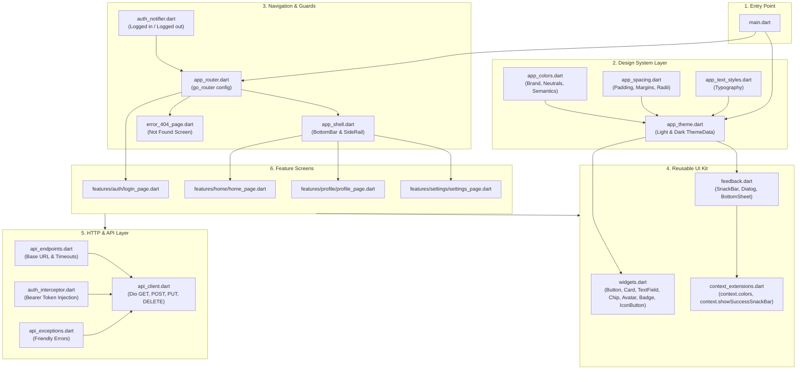

# 🚀 The Complete Guide to Your Flutter Design System Starter Template

Welcome! This guide explains everything about the Flutter Design System Starter Template you now own. It is written in simple, plain English so you can understand what every part does, why it is placed where it is, how all parts connect together, and how to use it step-by-step for any new project you build in the future.

---

## 📑 Table of Contents
1. [The Big Picture: What is This Template?](#1-the-big-picture-what-is-this-template)
2. [Architecture Map: How Everything Connects](#2-architecture-map-how-everything-connects)
3. [Folder Breakdown: What Every File Does & Why](#3-folder-breakdown-what-every-file-does--why)
   - [Core: The Engine Room (`lib/core/`)](#core-the-engine-room-libcore)
     - [Theme & Design Tokens (`core/config/theme/`)](#theme--design-tokens-coreconfigtheme)
     - [Reusable Widgets (`core/common/widgets/`)](#reusable-widgets-corecommonwidgets)
     - [Feedback Utilities (`core/common/feedback/`)](#feedback-utilities-corecommonfeedback)
     - [Developer Shortcuts (`core/utils/extensions/`)](#developer-shortcuts-coreutilsextensions)
     - [Routing & Auth Guard (`core/router/`)](#routing--auth-guard-corerouter)
     - [Networking & API Client (`core/network/`)](#networking--api-client-corenetwork)
   - [Features: The User Screens (`lib/features/`)](#features-the-user-screens-libfeatures)
   - [Root Files (`main.dart`, `pubspec.yaml`)](#root-files-maindart-pubspecyaml)
4. [The Chain Reaction: How One Change Updates Everything](#4-the-chain-reaction-how-one-change-updates-everything)
5. [Step-by-Step: How to Use This Template for a New Project](#5-step-by-step-how-to-use-this-template-for-a-new-project)
6. [Developer Cheat Sheet (Everyday Code Examples)](#6-developer-cheat-sheet-everyday-code-examples)

---

## 1. The Big Picture: What is This Template?

When developers start a new Flutter app from scratch, they usually waste days repeating the same tasks:
* Hardcoding colors like `Color(0xFF6C63FF)` in 50 different places.
* Re-inventing buttons, cards, text fields, and dialogs.
* Struggling with dark mode when the client asks for it later.
* Setting up navigation, back buttons, and protected login screens.
* Writing HTTP network code with boilerplate error handling.

**This starter template solves all of that upfront.**

It gives you a complete, production-ready foundation built on three golden rules:
1. **Single Source of Truth**: Every color, font size, and spacing value is written once. If you change your brand color in one file, the entire app (buttons, borders, icons, snackbars) updates automatically.
2. **Zero Hardcoded Values**: No magic numbers or random colors anywhere in your UI widgets.
3. **100% Plug-and-Play Portability**: All imports inside `lib/` use relative paths (`../../`). That means you can copy this code into a project named `uber_clone`, `spendly`, or `my_shop`, and it will work instantly without any renaming headaches.

---

## 2. Architecture Map: How Everything Connects

Here is a visual map showing how the different layers talk to each other:



---

## 3. Folder Breakdown: What Every File Does & Why

The project is split cleanly into two top-level directories under `lib/`:
* `core/`: Things that are shared across the whole app (theme, network, reusable buttons, router).
* `features/`: The actual screens and user flows (login, home, profile, settings).

### Core: The Engine Room (`lib/core/`)

#### Theme & Design Tokens (`core/config/theme/`)
Design tokens are the smallest building blocks of visual design.

| File | What it does | Why it exists here |
|---|---|---|
| [`app_colors.dart`](file:///c:/Users/USER/Desktop/Flutter%20Materials/flutter_design_system_starter-main/flutter_design_system_starter-main/lib/core/config/theme/app_colors.dart) | Stores every color palette (Primary brand, secondary, greys 100-900, success green, warning orange, error red). | When you build a new project, this is the only color file you ever need to change. |
| [`app_spacing.dart`](file:///c:/Users/USER/Desktop/Flutter%20Materials/flutter_design_system_starter-main/flutter_design_system_starter-main/lib/core/config/theme/app_spacing.dart) | Defines standard spacing numbers (`xs: 4`, `sm: 8`, `md: 16`, `lg: 24`, `xl: 32`, `xxl: 48`) and border curves (`AppRadius.sm`, `md`, `lg`, `full`). | Prevents random padding numbers like `13.5` or `27` so your layout looks consistent on all screens. |
| [`app_text_styles.dart`](file:///c:/Users/USER/Desktop/Flutter%20Materials/flutter_design_system_starter-main/flutter_design_system_starter-main/lib/core/config/theme/app_text_styles.dart) | Defines standard typography (`displayLarge`, `titleMedium`, `bodyLarge`, etc.). | Allows you to configure font weights, sizes, and font families in one place. |
| [`app_theme.dart`](file:///c:/Users/USER/Desktop/Flutter%20Materials/flutter_design_system_starter-main/flutter_design_system_starter-main/lib/core/config/theme/app_theme.dart) | Packages colors, spacing, and text styles into official Flutter `ThemeData` for both **Light Mode** and **Dark Mode**. | Flutter uses this to automatically color AppBars, input borders, buttons, and backgrounds. |

---

#### Reusable Widgets (`core/common/widgets/`)
These are ready-made UI components built on top of your tokens. You don't have to rebuild them in every new project.

| File | Component | What it does & Features |
|---|---|---|
| [`app_button.dart`](file:///c:/Users/USER/Desktop/Flutter%20Materials/flutter_design_system_starter-main/flutter_design_system_starter-main/lib/core/common/widgets/app_button.dart) | `AppButton` | The main action button. Supports 4 variants (`primary`, `outlined`, `ghost`, `danger`), 3 sizes (`sm`, `md`, `lg`), `leadingIcon`, `trailingIcon`, loading spinner (`isLoading: true`), and full-width toggle (`isFullWidth`). |
| [`app_card.dart`](file:///c:/Users/USER/Desktop/Flutter%20Materials/flutter_design_system_starter-main/flutter_design_system_starter-main/lib/core/common/widgets/app_card.dart) | `AppCard` | A container surface with 3 variants (`elevated` with soft shadow, `outlined` with border, `filled`). Uses `InkWell` to provide touch ripples on mobile and hover highlights on Web/Desktop. |
| [`app_text_field.dart`](file:///c:/Users/USER/Desktop/Flutter%20Materials/flutter_design_system_starter-main/flutter_design_system_starter-main/lib/core/common/widgets/app_text_field.dart) | `AppTextField` | Clean text input field with labels, hints, prefix/suffix icons, passwords (`obscureText`), validation, and automatic border coloring (focus blue, error red, disabled grey). |
| [`app_chip.dart`](file:///c:/Users/USER/Desktop/Flutter%20Materials/flutter_design_system_starter-main/flutter_design_system_starter-main/lib/core/common/widgets/app_chip.dart) | `AppChip` | Compact tags or selectable filters. Supports filled and outlined styles, icons, selection state, and delete action. |
| [`app_icon_button.dart`](file:///c:/Users/USER/Desktop/Flutter%20Materials/flutter_design_system_starter-main/flutter_design_system_starter-main/lib/core/common/widgets/app_icon_button.dart) | `AppIconButton` | Circular or rounded action buttons for AppBars and toolbars (`ghost`, `filled`, `outlined`) with built-in tooltips and loading state. |
| [`app_avatar.dart`](file:///c:/Users/USER/Desktop/Flutter%20Materials/flutter_design_system_starter-main/flutter_design_system_starter-main/lib/core/common/widgets/app_avatar.dart) | `AppAvatar` | User profile avatar. Supports internet image URLs (with loading & error states), automatic initials generator (e.g. `"John Doe"` $\rightarrow$ `"JD"`), and online/offline status dots. |
| [`app_badge.dart`](file:///c:/Users/USER/Desktop/Flutter%20Materials/flutter_design_system_starter-main/flutter_design_system_starter-main/lib/core/common/widgets/app_badge.dart) | `AppBadge` | Status pills (e.g. "Active", "Pending") or badge counter overlays (e.g. `AppBadge.count(count: 5, child: Icon(Icons.notifications))` which auto-formats to `99+`). |
| [`widgets.dart`](file:///c:/Users/USER/Desktop/Flutter%20Materials/flutter_design_system_starter-main/flutter_design_system_starter-main/lib/core/common/widgets/widgets.dart) | Barrel Export | Bundles all above widgets into a single export so you can import them with one line. |

---

#### Feedback Utilities (`core/common/feedback/`)
Instead of writing 15 lines of boilerplate every time you want to show a message or popup, these utilities do it in one clean call:

| File | Utility | What it provides |
|---|---|---|
| [`app_snack_bar.dart`](file:///c:/Users/USER/Desktop/Flutter%20Materials/flutter_design_system_starter-main/flutter_design_system_starter-main/lib/core/common/feedback/app_snack_bar.dart) | `AppSnackBar` | Floating banner alerts with icons and semantic colors (`success`, `error`, `warning`, `info`). |
| [`app_dialog.dart`](file:///c:/Users/USER/Desktop/Flutter%20Materials/flutter_design_system_starter-main/flutter_design_system_starter-main/lib/core/common/feedback/app_dialog.dart) | `AppDialog` | Styled popups: `showConfirmation(...)` with Confirm/Cancel buttons and destructive styling, `showAlert(...)`, and `showCustom(...)`. |
| [`app_bottom_sheet.dart`](file:///c:/Users/USER/Desktop/Flutter%20Materials/flutter_design_system_starter-main/flutter_design_system_starter-main/lib/core/common/feedback/app_bottom_sheet.dart) | `AppBottomSheet` | Bottom sliding sheet with a top drag handle, title divider, rounded corners, and keyboard avoidance. |
| [`feedback.dart`](file:///c:/Users/USER/Desktop/Flutter%20Materials/flutter_design_system_starter-main/flutter_design_system_starter-main/lib/core/common/feedback/feedback.dart) | Barrel Export | Exports all feedback helpers in one line. |

---

#### Developer Shortcuts (`core/utils/extensions/`)
* File: [`context_extensions.dart`](file:///c:/Users/USER/Desktop/Flutter%20Materials/flutter_design_system_starter-main/flutter_design_system_starter-main/lib/core/utils/extensions/context_extensions.dart)
* **Why it exists**: Saves you from writing verbose Flutter code:
  * Instead of `Theme.of(context).colorScheme.primary`, just write `context.colors.primary`.
  * Instead of `Theme.of(context).textTheme.titleLarge`, just write `context.textTheme.titleLarge`.
  * Instead of `ScaffoldMessenger.of(context).showSnackBar(...)`, just write:
    ```dart
    context.showSuccessSnackBar('Payment completed!');
    context.showErrorSnackBar('Network error occurred.');
    context.showConfirmationDialog(title: 'Delete Item', message: 'Are you sure?');
    ```

---

#### Routing & Auth Guard (`core/router/`)
Powered by Flutter's official **`go_router`** package:

| File | What it does |
|---|---|
| [`app_routes.dart`](file:///c:/Users/USER/Desktop/Flutter%20Materials/flutter_design_system_starter-main/flutter_design_system_starter-main/lib/core/router/app_routes.dart) | Holds route paths as constants (`home = '/'`, `login = '/login'`, `profile = '/profile'`, `settings = '/settings'`). Prevents typos. |
| [`auth_notifier.dart`](file:///c:/Users/USER/Desktop/Flutter%20Materials/flutter_design_system_starter-main/flutter_design_system_starter-main/lib/core/router/auth_notifier.dart) | A simple authentication tracker (`isAuthenticated`, `logIn()`, `logOut()`). When state changes, it automatically notifies the router to redirect the user. |
| [`app_router.dart`](file:///c:/Users/USER/Desktop/Flutter%20Materials/flutter_design_system_starter-main/flutter_design_system_starter-main/lib/core/router/app_router.dart) | The central router. Configured with an **Auth Guard**: if a user is not logged in and tries to access Home, they are redirected to `/login`. If they are already logged in and try to visit `/login`, they are redirected to `/`. |
| [`app_shell.dart`](file:///c:/Users/USER/Desktop/Flutter%20Materials/flutter_design_system_starter-main/flutter_design_system_starter-main/lib/core/router/app_shell.dart) | The common layout wrapper. On mobile, it displays a `NavigationBar` at the bottom. On tablets and desktops ($\ge 768\text{px}$), it automatically switches to a side `NavigationRail`. |
| [`page_transitions.dart`](file:///c:/Users/USER/Desktop/Flutter%20Materials/flutter_design_system_starter-main/flutter_design_system_starter-main/lib/core/router/page_transitions.dart) | Provides smooth animations (`fade`, `slideFromRight`, `slideFromBottom`, `scale`) when moving between screens. |
| [`error_404_page.dart`](file:///c:/Users/USER/Desktop/Flutter%20Materials/flutter_design_system_starter-main/flutter_design_system_starter-main/lib/core/router/error_404_page.dart) | A styled screen that automatically appears if a user navigates to an invalid route. Includes a "Back to Home" button. |

---

#### Networking & API Client (`core/network/`)
Powered by the industry-standard **`dio`** library:

| File | What it does |
|---|---|
| [`api_endpoints.dart`](file:///c:/Users/USER/Desktop/Flutter%20Materials/flutter_design_system_starter-main/flutter_design_system_starter-main/lib/core/network/api_endpoints.dart) | Central place for your backend API `baseUrl` and timeout configurations (15 seconds default). |
| [`auth_interceptor.dart`](file:///c:/Users/USER/Desktop/Flutter%20Materials/flutter_design_system_starter-main/flutter_design_system_starter-main/lib/core/network/auth_interceptor.dart) | Intercepts every outgoing request and automatically attaches your authentication header: `Authorization: Bearer <token>`. If the backend responds with `401 Unauthorized`, it automatically calls your logout handler. |
| [`logging_interceptor.dart`](file:///c:/Users/USER/Desktop/Flutter%20Materials/flutter_design_system_starter-main/flutter_design_system_starter-main/lib/core/network/logging_interceptor.dart) | In debug mode, it prints formatted logs to your terminal showing the HTTP method, URL, headers, request body, status code, and response payload. |
| [`api_exceptions.dart`](file:///c:/Users/USER/Desktop/Flutter%20Materials/flutter_design_system_starter-main/flutter_design_system_starter-main/lib/core/network/api_exceptions.dart) | Converts raw network crashes into user-friendly exceptions (`TimeoutException`, `NetworkConnectionException`, `UnauthorizedException`, `NotFoundException`, `ServerException`). It also automatically reads error messages sent back by your server. |
| [`api_client.dart`](file:///c:/Users/USER/Desktop/Flutter%20Materials/flutter_design_system_starter-main/flutter_design_system_starter-main/lib/core/network/api_client.dart) | The main helper exposing clean `get()`, `post()`, `put()`, `patch()`, and `delete()` methods. It automatically wraps everything in `try/catch` and throws typed `ApiException`s. |

---

### Features: The User Screens (`lib/features/`)

Features are organized by screen or business capability. Each feature contains its own presentation layer:

* [`features/auth/presentation/pages/login_page.dart`](file:///c:/Users/USER/Desktop/Flutter%20Materials/flutter_design_system_starter-main/flutter_design_system_starter-main/lib/features/auth/presentation/pages/login_page.dart): Sign-in screen showcasing `AppCard`, `AppTextField`, `AppButton`, form validation, password obscure toggle, and calling `authNotifier.logIn()`.
* [`features/home/presentation/pages/home_page.dart`](file:///c:/Users/USER/Desktop/Flutter%20Materials/flutter_design_system_starter-main/flutter_design_system_starter-main/lib/features/home/presentation/pages/home_page.dart): Home screen showcasing `AppAvatar`, `AppBadge`, action buttons, chips, and quick feedback triggers.
* [`features/profile/presentation/pages/profile_page.dart`](file:///c:/Users/USER/Desktop/Flutter%20Materials/flutter_design_system_starter-main/flutter_design_system_starter-main/lib/features/profile/presentation/pages/profile_page.dart): User profile screen with avatar, email, and list items.
* [`features/settings/presentation/pages/settings_page.dart`](file:///c:/Users/USER/Desktop/Flutter%20Materials/flutter_design_system_starter-main/flutter_design_system_starter-main/lib/features/settings/presentation/pages/settings_page.dart): Settings screen demonstrating options and a working Log Out action.

---

### Root Files (`main.dart`, `pubspec.yaml`)

* [`main.dart`](file:///c:/Users/USER/Desktop/Flutter%20Materials/flutter_design_system_starter-main/flutter_design_system_starter-main/lib/main.dart): The application entry point. Configures `MaterialApp.router` with `AppTheme.lightTheme`, `AppTheme.darkTheme`, `ThemeMode.system`, and `routerConfig: appRouter`.
* [`pubspec.yaml`](file:///c:/Users/USER/Desktop/Flutter%20Materials/flutter_design_system_starter-main/flutter_design_system_starter-main/pubspec.yaml): Defines the project dependencies (`flutter`, `cupertino_icons`, `go_router`, `dio`, `flutter_lints`).

---

## 4. The Chain Reaction: How One Change Updates Everything

To appreciate why this architecture is powerful, look at how a single change ripples through the entire system:

### Example: Changing Your Brand Color
Suppose your next app uses Emerald Green (`#10B981`) instead of Purple (`#6C63FF`).

1. You open [`app_colors.dart`](file:///c:/Users/USER/Desktop/Flutter%20Materials/flutter_design_system_starter-main/flutter_design_system_starter-main/lib/core/config/theme/app_colors.dart) and change one line:
   ```dart
   static const Color primary = Color(0xFF10B981); // Emerald Green
   ```
2. **What happens automatically:**
   * [`app_theme.dart`](file:///c:/Users/USER/Desktop/Flutter%20Materials/flutter_design_system_starter-main/flutter_design_system_starter-main/lib/core/config/theme/app_theme.dart) updates both `lightColorScheme` and `darkColorScheme`.
   * All `AppButton` widgets with variant `primary` immediately turn Emerald Green.
   * Outlined buttons get Emerald Green borders and text.
   * `AppTextField` focused borders glow Emerald Green.
   * `AppChip` selected backgrounds become Emerald Green.
   * `AppAvatar` initials backgrounds adopt Emerald Green.
   * Active tab icons in the navigation bar/rail turn Emerald Green.
   * `AppSnackBar` info badges update their highlight.

**You touched exactly one line of code.** You didn't have to search through 30 files or fix broken button colors.

---

## 5. Step-by-Step: How to Use This Template for a New Project

Follow these exact steps whenever you want to start a brand new app:

### Step 1: Create Your New Project
Run standard `flutter create` with your preferred organization and app name in your terminal:
```bash
flutter create --org com.yourcompany my_new_app
cd my_new_app
```

### Step 2: Copy the Starter Code
1. Open your newly created `my_new_app` project folder.
2. Replace its `lib/` directory with the `lib/` directory from this starter template.
3. Open `pubspec.yaml` in your new project and add the dependencies:
   ```yaml
   dependencies:
     flutter:
       sdk: flutter
     cupertino_icons: ^1.0.8
     go_router: ^17.5.0
     dio: ^5.11.1
   ```
4. Run:
   ```bash
   flutter pub get
   ```

> [!NOTE]
> Because all internal imports in `lib/` use relative paths (`../../`), you will get **zero import errors** when copying this folder into your new project!

---

### Step 3: Customize to Your Project's Requirements

Now customize the template for your specific project:

#### 1. Set Your Brand Colors
Open `lib/core/config/theme/app_colors.dart`:
```dart
abstract class AppColors {
  // Replace these with your project's brand palette:
  static const Color primary   = Color(0xFF2563EB); // Your new primary
  static const Color secondary = Color(0xFF10B981); // Your new secondary
  ...
}
```

#### 2. Set Your API URL
Open `lib/core/network/api_endpoints.dart`:
```dart
abstract class ApiEndpoints {
  // Put your real backend API URL here:
  static const String baseUrl = 'https://api.yourdomain.com/v1';
}
```

#### 3. Define Your Routes & Screens
1. Open `lib/core/router/app_routes.dart` and add your project's page paths:
   ```dart
   abstract class AppRoutes {
     static const String home = '/';
     static const String login = '/login';
     static const String products = '/products';
     static const String cart = '/cart';
     static const String checkout = '/checkout';
   }
   ```
2. Open `lib/core/router/app_router.dart` and map those routes to your new screens.
3. If you want a screen to be protected (require login), the built-in `redirect` guard will protect it automatically!

---

## 6. Developer Cheat Sheet (Everyday Code Examples)

Keep this cheat sheet handy while coding:

### 1. Buttons
```dart
// Primary full-width button
AppButton(
  label: 'Save Changes',
  onPressed: () => handleSave(),
)

// Button with loading spinner (automatically disables tap)
AppButton(
  label: 'Submitting',
  isLoading: isSubmitting,
  onPressed: () => submitForm(),
)

// Outlined button with leading icon, medium size, hugging content
AppButton(
  label: 'Export PDF',
  variant: AppButtonVariant.outlined,
  size: AppButtonSize.md,
  isFullWidth: false,
  leadingIcon: const Icon(Icons.download_rounded),
  onPressed: () => exportPdf(),
)

// Danger button (red)
AppButton(
  label: 'Delete Account',
  variant: AppButtonVariant.danger,
  onPressed: () => confirmDelete(),
)
```

---

### 2. Feedback (Toasts, Popups & Bottom Sheets)
```dart
// Success banner
context.showSuccessSnackBar('Profile updated successfully!', title: 'Success');

// Error banner
context.showErrorSnackBar('Unable to connect to server.');

// Confirmation Dialog
final confirmed = await context.showConfirmationDialog(
  title: 'Discard Changes?',
  message: 'Any unsaved edits will be permanently lost.',
  confirmLabel: 'Discard',
  isDestructive: true,
);
if (confirmed == true) {
  // user tapped Discard
}

// Bottom Sheet
context.showAppBottomSheet(
  title: 'Filter Results',
  child: Column(
    children: [
      Text('Filter options here...'),
    ],
  ),
);
```

---

### 3. API Requests with `apiClient`
```dart
import 'package:your_app/core/network/network.dart';

// 1. Making a GET request
try {
  final response = await apiClient.get('/products');
  final products = response.data; // Already parsed JSON!
} on ApiException catch (e) {
  // Shows user-friendly message (e.g. "No internet connection" or server error)
  context.showErrorSnackBar(e.message);
}

// 2. Making a POST request
try {
  final response = await apiClient.post(
    '/auth/login',
    data: {'email': email, 'password': password},
  );
  
  // Set auth token (auto-attached to all future requests!)
  final token = response.data['token'];
  apiClient.setAuthToken(token);
  authNotifier.logIn(); // Automatically navigates home
} on ApiException catch (e) {
  context.showErrorSnackBar(e.message);
}
```

---

### 4. Avatars & Badges
```dart
// Avatar with initials and active dot
AppAvatar(
  name: 'Sarah Connor',
  size: AppAvatarSize.lg,
  isOnline: true,
)

// Avatar with web image and fallback
AppAvatar(
  imageUrl: 'https://example.com/photo.jpg',
  name: 'Sarah Connor',
  size: AppAvatarSize.md,
)

// Standalone status pill
AppBadge(
  label: 'Active',
  variant: AppBadgeVariant.success,
  style: AppBadgeStyle.subtle,
)

// Notification bell icon with numeric badge counter
AppBadge.count(
  count: 3,
  child: Icon(Icons.notifications_none_rounded),
)
```

---

### Summary
You now have a clean, modular, and battle-tested Flutter design system template. Everything is organized, decoupled, and ready to power your next production application with maximum speed and consistency. Happy coding!
